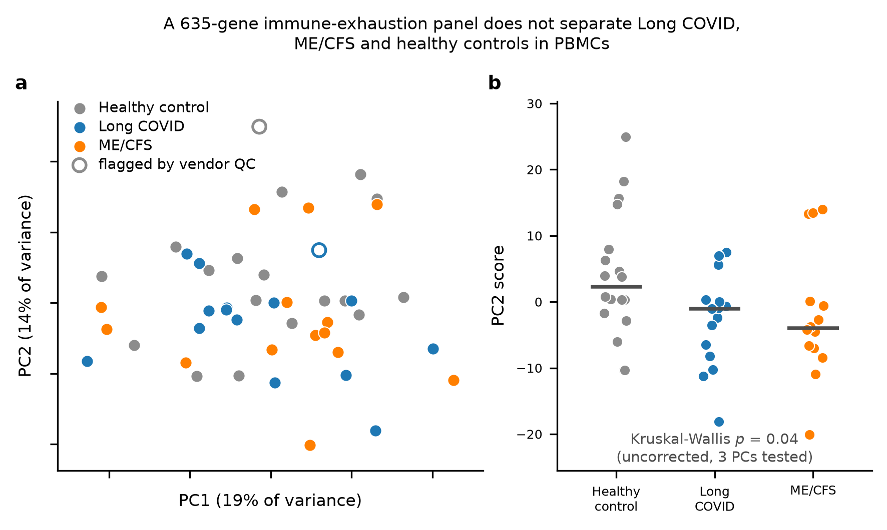

# Immune exhaustion markers in Long COVID and ME/CFS: a reanalysis of GSE275334

A small reanalysis of a public PBMC gene-expression dataset comparing Long
COVID, ME/CFS and healthy controls. The goal was to check whether the published
"immune exhaustion" panel separates the three groups in an unsupervised
analysis, before any gene-level testing.

**Short answer: it does not.** The first three principal components carry no
convincing group signal.



## The data

[GSE275334](https://www.ncbi.nlm.nih.gov/geo/query/acc.cgi?acc=GSE275334) —
NanoString nCounter panel on peripheral blood mononuclear cells.

| | |
|---|---|
| Genes | 635 (targeted panel, not whole transcriptome) |
| Samples | 47 |
| Groups | 18 healthy control, 15 Long COVID, 14 ME/CFS |
| Covariates | age, sex |
| Download | ~900 kB; no data-use agreement required |

Age and sex are well matched across groups (median age 43 / 44 / 41.5;
72–79 % female in each group), so neither is a plausible driver of group
differences here.

## How the dataset was chosen

Five GEO series were evaluated. Three were excluded, and the reasons are worth
recording because they are not visible from the series titles:

| Accession | Why excluded |
|---|---|
| GSE267625 | Whole blood, 111 samples — but **no healthy controls**. Every sample is post-COVID; the only contrast is 3 vs 12 months. |
| GSE261777 | Nasal epithelium, 55 samples — same cohort (P4O2), also **no healthy controls**. |
| GSE224615 | Only a differential-expression spreadsheet is deposited; no expression matrix, so nothing can be recomputed. |

GSE275334 was chosen because it has a genuine three-group design, posts both
raw and normalised counts, and includes the vendor QC sheet.

## Method

1. `src/load_data.py` — downloads the normalised-counts workbook and the GEO
   series matrix, parses `!Sample_characteristics_ch1` into a tidy sample table,
   joins the vendor QC metrics, and asserts that the expression columns and the
   sample table describe the same 47 samples.
2. `src/pca.py` — z-scores each gene across samples so all 635 contribute
   equally, runs PCA as an SVD of the centred sample × gene matrix, and tests
   each of the first three PCs against group (Kruskal–Wallis), age (Spearman)
   and sex (Mann–Whitney).

One join detail worth flagging: the expression columns are **not** in sorted
order — `LC05` precedes `LC01`, and `ME13`/`ME14` come first. Aligning samples
by column position rather than by ID would silently mislabel 17 of 47 samples.
The sample IDs in the expression sheet (`HC01`) also differ from the titles in
the series matrix (`Healthy Control #1`), so the two have to be mapped
explicitly.

## Results

Variance explained: PC1 18.7 %, PC2 13.6 %, PC3 11.9 % — a slow decay, i.e. no
dominant axis of variation.

| PC | Group (Kruskal–Wallis) | Age (Spearman) | Sex (Mann–Whitney) |
|---|---|---|---|
| PC1 | p = 0.74 | ρ = −0.17, p = 0.24 | p = 0.46 |
| PC2 | **p = 0.044** | ρ = +0.10, p = 0.49 | p = 0.95 |
| PC3 | p = 0.87 | ρ = +0.02, p = 0.88 | p = 0.91 |

PC2 is nominally associated with group, but these p-values are uncorrected and
three PCs were tested; at a Bonferroni threshold of 0.05/3 = 0.017 it does not
hold. I would not report this as a finding.

Age and sex show no association with any of the first three PCs, which is the
useful negative control: whatever structure PC1–PC3 capture, it is not
demographic.

## Limitations

- **Unsupervised analysis is a weak test.** A real group difference confined to
  a handful of genes can easily be invisible in a PCA of 635 z-scored genes.
  "No separation in PCA" is not "no difference" — it bounds the effect size,
  nothing more.
- **n = 47** across three groups. Underpowered for anything but large effects.
- Two samples carry vendor QC flags (one positive-control scaling issue, one low
  housekeeping-gene count). They are retained in the PCA and drawn as open
  markers in the figure; they do not sit apart from the rest.
- Normalised counts are used as deposited. The normalisation was not redone.
- The panel is targeted, so absence of a signal is partly a statement about
  panel design.

## Reproducing

```
pip install pandas numpy scipy matplotlib openpyxl
python src/load_data.py   # downloads into data/, writes samples.csv + expression matrices
python src/pca.py         # writes data/pca_scores.csv and figures/pca_groups.png
```

Both scripts are idempotent and skip downloads that already exist. Tested on
Python 3.11.

## Files

```
src/load_data.py   download, parse, join, validate
src/pca.py         PCA + confounder checks + figure
src/style.py       plotting helpers (no external style dependency)
data/samples.csv   47 rows: id, GEO accession, group, age, sex, QC metrics
data/pca_scores.csv  sample metadata plus PC1-PC5 scores
figures/pca_groups.png
```

## Source

Data from GEO accession GSE275334. This repository is an independent
reanalysis; it is not affiliated with the original authors, and any errors here
are mine.
